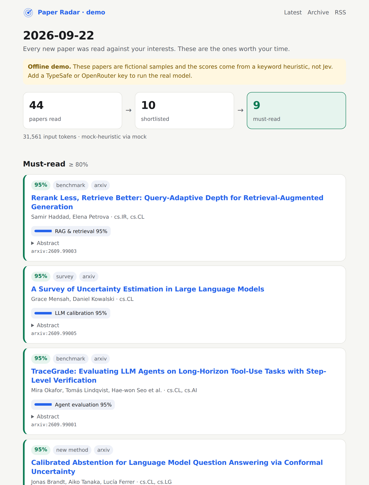

<div align="center">

# ◎ Paper Radar 論文雷達

**用白話寫下研究興趣，得到有理由、可繼續整理的論文清單。**

**[先在瀏覽器看成品](https://eliot5566.github.io/JEV-Paper-Radar/try/?lang=zh)** · [English](https://eliot5566.github.io/JEV-Paper-Radar/try/) — 不需先下載，先看使用有標示摘要重述的真實論文實測，也保留虛構示範。

**在 Claude 裡直接試用：**[下載技能 ZIP](https://github.com/Eliot5566/JEV-Paper-Radar/releases/download/claude-skill-v0.2.0/paper-radar-claude-v0.2.0.zip) · **[安裝教學](docs/claude-install.md#繁體中文)**。上傳啟用 0.2.0 後，只需研究興趣或 arXiv／PubMed／DOI 連結，技能取得公開標題摘要，再在目前對話排序與匯出。不必先整理 CSV，不需 pip 或額外模型 API 金鑰；檢索需要允許連線或既有 Claude 網頁工具，仍使用對話額度。

**[用兩個真實連結試一次](docs/first-run.md#繁體中文)** · [查看實測結果](https://eliot5566.github.io/JEV-Paper-Radar/try/real/) · [回報首次使用經驗](https://github.com/Eliot5566/JEV-Paper-Radar/issues/new?template=first-run.yml)。成功與卡住都歡迎回報。

每日自動化可用 Claude API：**[API 入門教學](docs/claude-quickstart.zh-TW.md)** · [English guide](docs/claude-quickstart.md) · [可 Fork 範例](https://github.com/Eliot5566/paper-radar-claude-example)。分數是自述的未校準數字，[初步觀察與限制](docs/claude-calibration.md)在此。

白話研究興趣 · 逐項分數 · 網頁與 RSS · Claude 對話或 Jev／Claude API 自動化

[English](README.md) · [Claude 入門](docs/claude-quickstart.zh-TW.md)



<sub>真實執行結果：Jev 在 5 秒內讀完 50 篇當日 arXiv 新論文，花費 $0.002。沒有金鑰也可以用 <code>paper-radar demo</code> 看到同樣的頁面。</sub>

</div>

---

arXiv 每月新投稿已超過 3 萬篇（[2026 年 6 月為 32,040 篇](https://blog.arxiv.org/2026/07/09/arxiv-now-hosts-over-3-million-articles/)），平均每個公告日約 1,500 篇。關鍵字提醒會漏掉用詞不同的論文；embedding 推薦會悄悄丟掉「不像你以前讀過」的東西；每天用聊天型 LLM 讀完全部，又慢又貴。

Paper Radar 的做法：每一篇新論文都交給 TypeSafe 的 System One 模型 [Jev](https://typesafe.ai/blog/introducing-system-one-models-and-jev)，依照你用白話寫的興趣逐條**判斷**。Jev 不生成文字，而是對每個興趣回傳一個校準過的機率，所以不用解析、也不會產生選項以外的答案。因為夠快、夠便宜，可以真的讀完*全部*，不必先粗篩。

實測（2026-09-23）：讀 50 篇花 5 秒、46,584 input tokens、約 $0.0020，平均每篇 932 tokens。換算讀完整個 arXiv（每工作日約 1,500 篇）約 $0.06／天。每次執行的實際用量都會記在 `data/runs.jsonl`。

## 先看一眼再決定要不要裝

這裡每個工作日都會自動更新一份公開雷達，不需要金鑰就能看到真實輸出：
**https://eliot5566.github.io/JEV-Paper-Radar/public/** （[RSS](https://eliot5566.github.io/JEV-Paper-Radar/public/feed.xml)）

它用的是刻意放寬的通用 AI 設定（`radar.public.toml`）。你自己的會窄得多，也有用得多。

## 每天早上你會得到

- **一個網頁**（GitHub Pages）：必讀、可能有興趣、差一點入選、被排除條件過濾掉的
- **RSS**（`feed.xml`）：可訂閱在任何閱讀器，也可以加進 Zotero（*檔案 → 新增 Feed*）
- **選配通知**：Slack、Discord、Telegram、Email
- **選配一句話摘要**：只替前 10 篇用任意 LLM 寫繁體中文 TL;DR（cascade 模式）
- **完整審計紀錄**：每個判斷、機率、模型版本都 commit 在 `data/`

## 5 分鐘上手（不需要伺服器）

1. **Fork 這個 repo**，到你 fork 的 **Actions** 分頁按下啟用 workflows（GitHub 對新 fork 預設關閉）。
2. **在 [`radar.toml`](radar.toml) 寫下你的興趣**，一條興趣一句白話：
   ```toml
   [[interests]]
   id = "agent_eval"
   label = "Agent 評測"
   text = "Benchmarks or methods for evaluating LLM agents on multi-step tool-use tasks"
   ```
   興趣用英文寫效果最好，因為論文摘要是英文。
3. **加入金鑰**：*Settings → Secrets and variables → Actions*
   - `TYPESAFE_API_KEY`（[console.typesafe.ai](https://console.typesafe.ai/settings/keys)），**或**
   - `OPENROUTER_API_KEY`：如果你還在 TypeSafe 的等候名單上，把 `backend` 設為 `"openrouter"`、`model` 設為 `"typesafe/jev-1.13"`。[OpenRouter 不需排隊](https://openrouter.ai/typesafe/jev-1.13)。
4. **開啟 Pages**：*Settings → Pages → Source: GitHub Actions*
5. **執行**：*Actions → Paper Radar → Run workflow*（第一次可在 limit 填 `50` 便宜試跑）

之後每個工作日 UTC 06:00（台灣時間 14 點）自動執行，預留資料來源更新時間；GitHub 排程仍可能延遲。

### 使用 Claude

建議從 [Claude 入門教學](docs/claude-quickstart.zh-TW.md)開始：離線示範、每次 20 篇的入門設定、API 金鑰、使用量檢查與個人標註驗證。也可安裝選用的 [Claude Code 技能](skills/paper-radar/SKILL.md)，或使用[完整自動發布範例](https://github.com/Eliot5566/paper-radar-claude-example)。

真實判斷需要 `ANTHROPIC_API_KEY`，API 另行計費，不包含在 Claude 聊天訂閱裡。Claude 自述分數不是校準過的機率；本專案的 Jev benchmark 不能直接套用。遇到問題可[回報設定問題](https://github.com/Eliot5566/JEV-Paper-Radar/issues/new?template=setup-help.yml)，或到[討論區分享使用經驗](https://github.com/Eliot5566/JEV-Paper-Radar/discussions)。

## 10 秒試玩（不需金鑰）

```bash
python -m pip install "paper-radar==0.2.0"
paper-radar demo
```

在自己的電腦上跑真實資料時，把金鑰放在 `radar.toml` 旁邊的 `.env`（已被 git 忽略，不會上傳）：

```bash
echo "TYPESAFE_API_KEY=你的金鑰" > .env
paper-radar check
paper-radar run --limit 50
```

真正的環境變數優先於 `.env`，所以同樣的指令在 GitHub Actions 上也一樣可用。

## 怎麼寫出 Jev 答得好的興趣

Jev 會照字面讀你的句子（見 [Jev 1.13 已知限制](https://docs.typesafe.ai/model-jaggedness/jev-1.13)）。`paper-radar check` 會自動提醒常見陷阱：

- 一條興趣只放一個概念，「A 和 B」拆成兩條
- 不要在興趣裡寫否定句；把「不要 X」改成 `[[exclude]]`，並用正面敘述（例如「主要應用是醫學影像」）
- 不要要求比較日期或數字，這些交給程式
- 次要興趣用 `weight = 0.5` 降權

實測（同一天 299 篇）：寫成單一明確概念的兩條興趣（「提出 benchmark 或評測方法」、「讓推論更快或更便宜」）各命中 14 篇高信心結果；同一組設定裡另外三條寫得籠統的（例如「明顯優於既有方法」）一篇都沒超過 0.95。

## 一鍵教它你的口味

頁面上每篇論文都有 👍 / 👎 兩個連結，點下去會開一個預先填好的 GitHub issue（標題是
`radar-label: <論文 id> yes`），送出就結束了。下一次執行會把這些 issue 收進
`data/labels.jsonl`、自動關閉它們，`calibrate` 就拿這些標註幫你調門檻。

在 GitHub Actions 上，連結會自動指向你自己的 repo（讀 `GITHUB_REPOSITORY`），所以 fork 不需要任何設定。
本機使用時，在 `radar.toml` 設 `output.feedback_repo = "owner/name"`，或執行 `paper-radar harvest --repo owner/name`。

## 校準到「你」

TypeSafe 公布的準確率與校準數據是自評的。用你自己的判斷來驗證：

```bash
paper-radar label 2609.01234 yes
paper-radar label 2609.04321 no
paper-radar calibrate --precision 0.9 --recall 0.9
```

會輸出 Brier score、ECE（期望校準誤差）、precision/recall 表，並建議達到目標的門檻值。

## 誠實的限制

- 只看摘要，不讀全文
- Jev 於 2026 年 9 月才以 early access 推出，官方數據尚無獨立重現，請固定 `model` 版本並用 `calibrate` 自行驗證
- 標題與摘要（公開資料）會送到你選的 API 供應商
- 本專案與 TypeSafe AI 無關聯

MIT 授權。

0.2.0 已加入判斷請求的使用量稽核（更早版本未包含）：`data/usage.jsonl` 保留輸入、輸出、快取與格式修復／失敗請求；缺少使用量或費率時顯示費用未知。歷史輸入估算不當成完整帳單，額外 TL;DR 生成也不在此範圍。詳見[使用量與成本說明](docs/usage-and-cost.md)。
